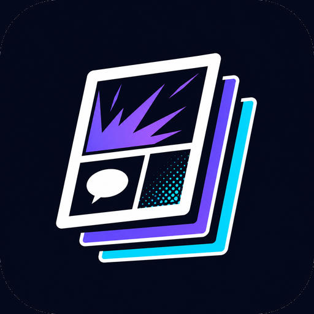
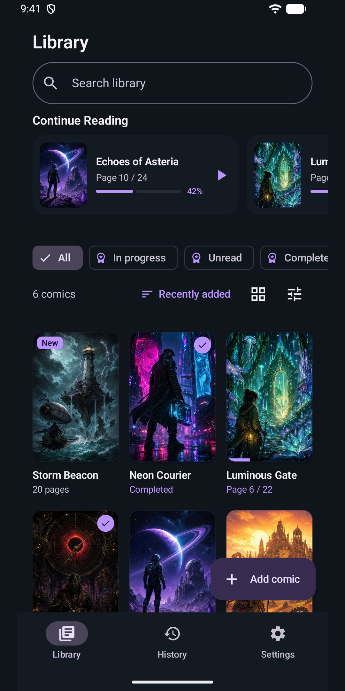
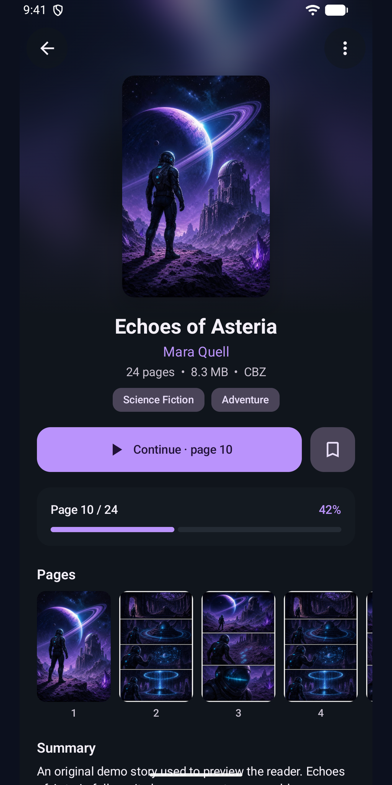

<div align="center">



# Comic Viewer

A fast, private reader for the comics already on your Android device: CBZ and ZIP archives,
PDF comics and folders of images.

[](https://github.com/Niklaus1911/ComicViewer/actions/workflows/android-ci.yml)
[](https://play.google.com/store/apps/details?id=com.comicviewer)

<a href="https://play.google.com/store/apps/details?id=com.comicviewer"></a>





</div>

## Features

- **Reads in place.** Pages come straight from your files: nothing is extracted, copied or
  uploaded, and no account is needed.
- **Library.** Add comics one by one, scan a folder, or let Auto discover find CBZ, ZIP and PDF
  comics on the device. Continue reading, search by title, series, writer or genre from
  `ComicInfo.xml`, and browse in grid, compact or list layouts.
- **Reader.** Swipe or tap to turn pages, or scroll vertically through webtoons. Pinch to zoom,
  with pages reloaded in sharper detail as you zoom in. A page grid to jump anywhere, and TalkBack
  labels for every page.
- **History and backup.** Reading history grouped by day, and backup and restore of the library,
  progress and settings.
- **Pro**, a one-time purchase: two-page spreads, right-to-left manga reading, fit width, fit
  height and original size, reader backgrounds, favorites, tags and extra color themes. PDF
  support and vertical scrolling stay free.

Comic Viewer runs on Android 7.0 and later, on phones and tablets, in English and Italian.

## Download

Install it from [Google Play](https://play.google.com/store/apps/details?id=com.comicviewer).
[GitHub releases](https://github.com/Niklaus1911/ComicViewer/releases) list what changed in each
version.

## Building

You need JDK 17 or later and the Android SDK; Android Studio provides both.

```sh
./gradlew assembleDebug        # debug APK in app/build/outputs/apk/debug/
./gradlew testDebugUnitTest    # unit tests
```

See [CONTRIBUTING.md](CONTRIBUTING.md) for the full set of checks, the code style and commit
messages, and [docs/RELEASING.md](docs/RELEASING.md) for publishing to Google Play.

## Project layout

| Path | Contents |
| --- | --- |
| [`app/`](app) | The app: library, storage, archive and PDF code, with the Compose UI in `ui/` |
| [`app/src/test/`](app/src/test), [`app/src/androidTest/`](app/src/androidTest) | Unit tests and device tests |
| [`fastlane/metadata/android/`](fastlane/metadata/android) | Store listing texts, screenshots and per-version release notes |
| [`scripts/`](scripts) | Google Play publishing, store listing upload and changelog tools |
| [`assets/`](assets) | Original demo artwork and the icon source |
| [`docs/`](docs) | Release process, store listing guide and design references |

## Changelog

What changed in each version is in [CHANGELOG.md](CHANGELOG.md).

## License

Copyright © 2026 Niklaus1911. All rights reserved; see [LICENSE](LICENSE).
