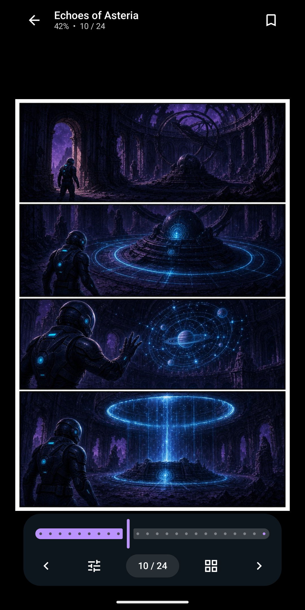
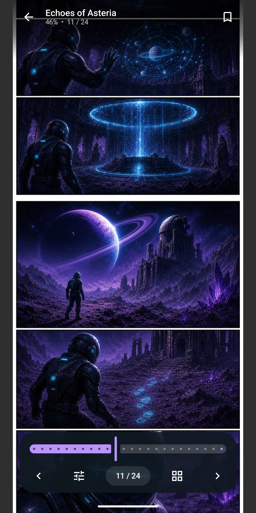

# Comic Viewer

A fast, private Android reader for the comics already on your device: CBZ and ZIP archives, PDF comics and folders of images. Pages are read straight from the files, nothing is extracted or uploaded, and no account is needed.

[Get it on Google Play](https://play.google.com/store/apps/details?id=com.comicviewer) · Android 7.0 or later · English and Italian

<p>
  
  
  
  
</p>

## Features

- **Library:** add single comics, scan a chosen folder, or let the app find CBZ and ZIP files on the device. Continue reading, search by title, series, writer or genre (from `ComicInfo.xml`), grid, compact and list layouts, and a reading history grouped by day.
- **Reader:** swipe or tap to turn pages, or scroll vertically through webtoons. Pinch to zoom, with pages reloaded in sharper detail as you zoom in. A page grid to jump anywhere, and TalkBack labels for every page.
- **Private:** works offline, with no ads, no account and no uploads. The library, progress and settings can be backed up and restored.
- **Pro** (one-time purchase): two-page spreads, right-to-left manga reading, fit width, fit height and original size, reader backgrounds, favorites, tags and extra color themes. PDF support and vertical scrolling stay free.

## Building

You need JDK 17 or later and the Android SDK (Android Studio is the easiest way to get both).

```sh
./gradlew assembleDebug          # debug APK in app/build/outputs/apk/debug/
./gradlew testDebugUnitTest      # unit tests
./gradlew connectedDebugAndroidTest  # device tests on a running emulator or phone
```

A signed release build (`./gradlew bundleRelease`) needs a local `keystore.properties`; copy `keystore.properties.example` and fill it in. Without it, release builds are unsigned. Never commit the keystore or its properties file.

GitHub Actions runs the unit tests on every push to `master`. Lint, the debug and minified release builds, and the device tests on an emulator run when started by hand from the Actions tab. Pushing a `vX.Y.Z` tag attaches a debug APK to a GitHub release.

## Project layout

| Path | Contents |
| --- | --- |
| `app/src/main/java/com/comicviewer/` | Library, storage, archive and PDF code |
| `app/src/main/java/com/comicviewer/ui/` | Compose screens by feature: library, reader, history, settings |
| `app/src/main/java/com/comicviewer/billing/` | The Pro in-app purchase |
| `app/src/test/`, `app/src/androidTest/` | Unit tests and device tests |
| `scripts/` | Google Play publishing and store listing scripts |
| `play-store-dashboard-assets/` | Store icon, feature graphic and screenshots |

[AGENTS.md](AGENTS.md) has the full architecture notes, coding conventions and the Google Play release steps.
